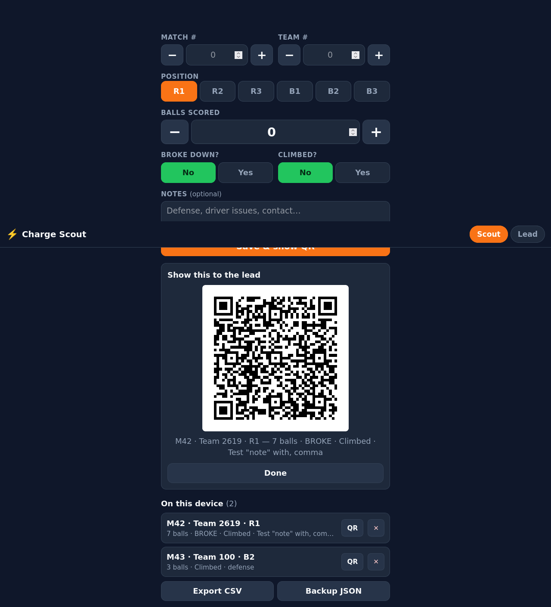
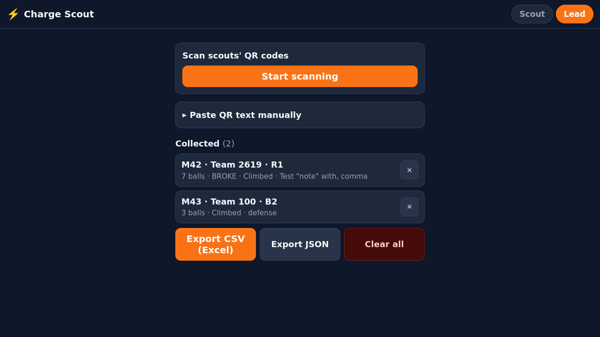

# Prototype — Charge Scout PWA (v1)

Status: **working prototype, tested 2026-11-19** (see test results below).
Location: `app/` — plain HTML/CSS/JS, no build step, fully offline.




## What it does

**Scout tab (data entry, during the match):**
1. Enter match #, team #, position (R1–B3), balls scored (big −/+ steppers),
   broke down? / climbed? toggles, optional notes.
2. **Save & show QR** → record is stored on the device and a QR code appears.
3. Match # auto-advances, team/notes clear for the next entry.
4. History list shows everything saved on the device; each row can re-show its QR or delete.
   Export CSV / Backup JSON for end-of-day safety.

**Lead tab (consolidation):**
1. **Start scanning** → rear camera scans scouts' QR codes continuously (duplicates ignored
   within 3 s; records deduped by id forever).
2. Fallback: paste the QR text manually (works when camera is unavailable).
3. **Export CSV (Excel)** → one file, all records, sorted by match then team, UTF-8 BOM so
   Excel opens it correctly, proper quoting for notes containing commas/quotes.
4. Export JSON / Clear all (with confirmation).

Both tabs live on the same device — the lead's phone is also a fine place to enter data
(single-scout workflow), and the two lists are the same underlying storage.

## Architecture decisions

| Decision | Choice | Why |
|---|---|---|
| App type | PWA (installable, service-worker cached) | One codebase for Android + iOS; $0; no store accounts; can be wrapped for stores later |
| Storage | `localStorage['charge-scout-records-v1']` | A day of matches is a few KB; no backend needed |
| QR transfer | compact JSON `{v:1,i,m,t,p,b,d,c,n,s}` | ~120–250 bytes/record → one scan per robot, robust at distance |
| QR libs | `qrcode-generator` + `jsQR`, **vendored** in `app/vendor/` | Zero network at venue; jsQR also powers the lead's camera scanner |
| CSV | RFC-4180-ish + UTF-8 BOM, `\r\n` | Opens cleanly in Excel/Sheets |
| Backend | none | Collection must never depend on a server (venue rules + congestion, see docs/03) |

## How to run

```bash
# from repo root — camera needs localhost or HTTPS
python3 -m http.server 8080 -d app
# open http://localhost:8080/index.html
```

**Live deployment:** https://shalmezad.com/FRC2619Scout/index.html
(deploy with `./deploy.sh` — see AGENTS.md → Deployment notes for the bucket/CloudFront setup
and the directory-URL quirk). Hosted on the team's existing S3 + CloudFront infra; free to run.
Open that URL on a phone and use "Add to Home Screen" to install it like a native app.

## Bug fixes from real-device testing (2026-11-19)

Found by testing the live deployment (laptop = lead, phone = scout):

1. **Team # field too skinny on mobile (showed ~1 digit).** Two causes: `.grid-2` used
   `1fr` tracks, which don't shrink below the inputs' intrinsic width — tracks blew out to
   368px each and the page overflowed 375px — and `type="number"` spinners ate width.
   Fixed: `minmax(0, 1fr)` tracks, `type="text" inputmode="numeric"` inputs (stepper logic
   hardened for text), 40px buttons + tighter padding in `.grid-2`.
   Verified at 375px: "2619" needs 43px, 54px available; no horizontal page overflow.
2. **Lead camera previewed but never scanned.** The decode loop tested
   `video.readyState >= video.videoWidth` — comparing state 4 against a pixel count (1280),
   always false — so jsQR never ran. Fixed to `video.HAVE_CURRENT_DATA`.
   The pipeline was extracted to module level as `__processFrame(source)` (testable with a
   canvas instead of a camera), throttled to ~15 fps, `inversionAttempts: 'attemptBoth'`.

**Deploy gotcha:** after `./deploy.sh`, devices show the *previous* build on their first
load (service worker stale-while-revalidate serves cache first, refreshes in background) and
the new build from the second load on. Reload once if you just deployed.

## Test results (Playwright, 2026-11-19)

| Test | Result |
|---|---|
| Page loads, zero console errors | ✅ |
| Form save → record in localStorage (incl. notes with quotes + comma) | ✅ |
| **QR roundtrip**: canvas → jsQR decode → exact record match | ✅ |
| Match auto-advance / team clear after save | ✅ |
| Lead ingest via QR text, count updates | ✅ |
| Duplicate scan deduped (no double-add) | ✅ |
| Garbage input rejected | ✅ |
| CSV: BOM, correct escaping, sorted rows | ✅ |
| **Offline acceptance test**: context set offline → full reload → app shell from SW cache, data intact, QR renders + decodes | ✅ |
| Service worker registered | ✅ |

Not yet tested on real phones (iOS Safari / Android Chrome) — **next step**.
Camera scanning path (`getUserMedia` + jsQR loop) is implemented but can only be
fully verified on a real device.

## Known limitations / next steps

- [ ] Real-device pass: iPhone (Safari "Add to Home Screen") + Android (Chrome install),
      camera scan test in good and bad lighting.
- [ ] Game-specific fields for 2027 (this season's game manual doesn't exist yet) — decide
      whether to hard-code or make configurable (see docs/README.md open questions).
- [ ] Optional: scout name/assignment field so the lead knows who submitted what.
- [ ] Optional: batch "scan next match" flow / sound on successful scan (currently vibration).
- [ ] Optional store packaging (Capacitor) **only if** the team wants App Store icons —
      requires Apple Developer account ($99/yr; educational waiver possible) — see docs/03.
